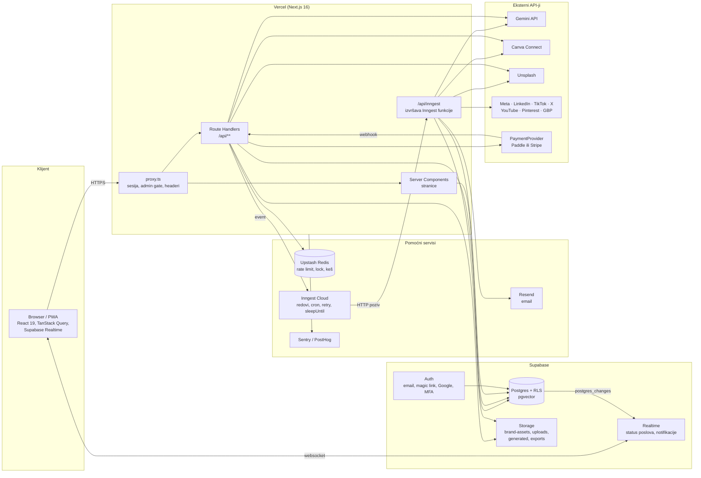
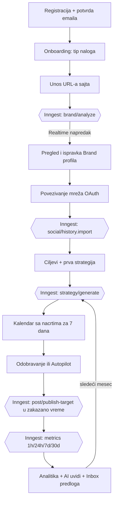
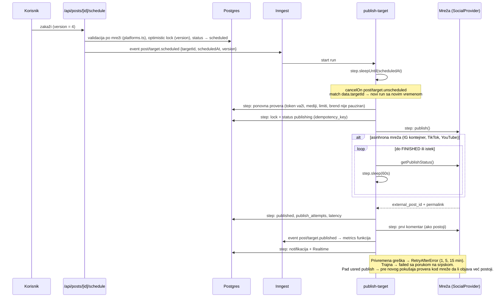
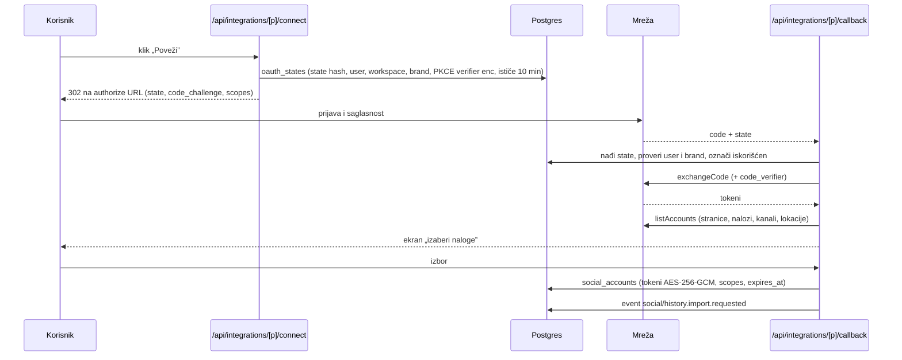

# Sova — arhitektura

Verzija dokumenta: 1.0 (faza 1, 23.10.2026). Status: **predlog, čeka odobrenje.**

Ovaj dokument opisuje celu platformu pre prvog reda koda. Detalji šeme baze i RLS politika su u [SCHEMA.md](SCHEMA.md), činjenice o svakoj mreži u [INTEGRATIONS.md](INTEGRATIONS.md), odluke sa razlozima u [DECISIONS.md](DECISIONS.md), ivični slučajevi u [EDGE_CASES.md](EDGE_CASES.md).

Sadržaj:

1. Pregled sistema
2. Struktura koda
3. Ključni tokovi (dijagrami)
4. Model podataka (ERD)
5. Bezbednosni model
6. Background poslovi (Inngest)
7. API rute
8. AI sloj i ekonomija tokena
9. Konfiguracija i okruženja
10. Rizici
11. Šta mi treba od tebe, po fazama
12. Predlog podele faza

---

## 1. Pregled sistema

Sova je jedna Next.js 16 aplikacija na Vercelu. Sve što traje duže od nekoliko sekundi ili mora da preživi pad procesa ide kroz Inngest. Podaci, autentifikacija, fajlovi i Realtime su na Supabase-u. Redis (Upstash) služi samo za rate limit, kratke lockove i keš.



Pravila koja važe za ceo sistem:

- **Jedan izvor istine za pristup je baza.** RLS je uključen na svakoj tabeli. Serverski kod proverava ulogu i pre upita, ali ako kod pogreši, baza odbija.
- **Sve što troši novac ide kroz rezervaciju tokena** (sekcija 8). Nema AI poziva bez prethodne rezervacije.
- **Spori poslovi vraćaju 202 i ID posla.** Klijent prati status preko Realtime-a na tabeli `ai_generations`, `website_crawls` ili `post_targets`.
- **Mreže su iza jednog interfejsa** (`SocialProvider`). Publisher, kalendar i analitika ne znaju ništa o pojedinačnoj mreži.
- **Tajne nikad ne napuštaju server.** Enkriptovani OAuth tokeni su u kolonama koje klijentska uloga ne može ni da selektuje (REVOKE na nivou kolone).

---

## 2. Struktura koda

```
sova/
├── src/
│   ├── app/
│   │   ├── (public)/            landing, login, register, forgot, reset, verify,
│   │   │                        privacy, terms, data-deletion, approve/[token]
│   │   ├── (app)/               sve stranice za ulogovane (layout sa sidebar-om)
│   │   │   ├── onboarding/
│   │   │   ├── dashboard/
│   │   │   ├── brand/           Brand Brain
│   │   │   ├── studio/          AI Studio
│   │   │   ├── composer/
│   │   │   ├── calendar/
│   │   │   ├── strategies/
│   │   │   ├── autopilot/
│   │   │   ├── inbox/           Inbox predloga
│   │   │   ├── media/
│   │   │   ├── approvals/
│   │   │   ├── analytics/
│   │   │   ├── history/
│   │   │   ├── integrations/
│   │   │   ├── team/
│   │   │   ├── settings/
│   │   │   ├── billing/
│   │   │   └── notifications/
│   │   ├── admin/               samo platform_admin, noindex
│   │   ├── api/                 Route Handlers (sekcija 7)
│   │   ├── auth/callback/
│   │   ├── error.tsx, global-error.tsx, not-found.tsx, loading.tsx
│   │   └── layout.tsx
│   ├── proxy.ts                 sesija + redirect + admin gate + bezbednosni headeri
│   ├── components/
│   │   ├── ui/                  shadcn/ui
│   │   ├── shared/              AsyncState, ConfirmDialog, TokenBadge, ...
│   │   └── <feature>/           komponente po modulu
│   ├── config/
│   │   ├── platforms.ts         ograničenja mreža (karakteri, formati, odnosi)
│   │   ├── token-prices.ts      podrazumevane cene; stvarne su u platform_settings
│   │   ├── limits.ts            rate limit vrednosti, veličine fajlova
│   │   └── models.ts            čita nazive modela iz env-a
│   ├── i18n/
│   │   ├── request.ts           next-intl
│   │   └── messages/sr-Latn.json, en.json
│   ├── integrations/
│   │   ├── types.ts             SocialProvider interfejs, NormalizedPost, NormalizedMetrics
│   │   ├── registry.ts          platform → provider, feature flag provera
│   │   ├── facebook/ instagram/ linkedin/ tiktok/ x/ youtube/ pinterest/ google-business/
│   │   │   └── provider.ts, auth.ts, publish.ts, metrics.ts, mappers.ts, errors.ts
│   │   ├── canva/
│   │   ├── unsplash/
│   │   └── assisted/            „objavi ručno” fallback provider
│   ├── inngest/
│   │   ├── client.ts
│   │   ├── events.ts            tipovi svih događaja (Zod)
│   │   └── functions/           jedna datoteka po funkciji (sekcija 6)
│   ├── lib/
│   │   ├── env.ts               Zod validacija env-a, import 'server-only'
│   │   ├── supabase/            server.ts (cookie sesija), client.ts, admin.ts (service role)
│   │   ├── api/                 handler wrapper, ApiError, odgovor { ok, data | error }
│   │   ├── auth/                getViewer(), requireRole(), impersonacija
│   │   ├── crypto/              AES-256-GCM sa verzijom ključa, HMAC za linkove
│   │   ├── ratelimit.ts         Upstash
│   │   ├── idempotency.ts
│   │   ├── ssrf.ts              validacija URL-a, DNS provera, bezbedan fetch
│   │   ├── logger.ts            strukturisan JSON, requestId, bez PII
│   │   ├── ai/                  gemini.ts (retry, fallback, breaker), cost.ts, prompts/
│   │   ├── tokens/              reserve/confirm/release wrapperi oko RPC-a
│   │   ├── posts/               state-machine.ts, validators.ts
│   │   ├── media/               sharp.ts, satori.ts, mime.ts
│   │   └── crawler/             discover.ts, fetch.ts, extract/*, colors.ts, fonts.ts
│   ├── services/                poslovna logika po modulu (brand-brain, studio, publisher,
│   │                            strategy, analytics, billing, admin, team)
│   └── emails/                  React Email šabloni
├── supabase/
│   ├── migrations/
│   ├── seed.sql
│   └── tests/                   pgTAP ili SQL testovi za RLS
├── tests/
│   ├── unit/ integration/ e2e/
│   ├── fixtures/                HTML sajtova za crawler, odgovori mreža
│   └── msw/                     mock handleri za Gemini, Unsplash, Canva, mreže
├── docs/
├── .github/workflows/ci.yml
└── .env.example
```

---

## 3. Ključni tokovi

### 3.1 Zlatna putanja korisnika



### 3.2 Ruta koja troši tokene (sinhrona, npr. tekst)

```mermaid
sequenceDiagram
    participant C as Klijent
    participant R as Route Handler
    participant RD as Redis
    participant DB as Postgres (RPC)
    participant G as Gemini

    C->>R: POST /api/ai/text (Idempotency-Key)
    R->>R: 1 sesija → 401, 2 pristup brendu + uloga → 403, 3 Zod → 400
    R->>RD: 4 rate limit (user, ip)
    RD-->>R: ok / 429 Retry-After
    R->>DB: 5 idempotency_keys: isti ključ? (done → vrati; in_progress → 409)
    R->>DB: 6 reserve_tokens(ws, brand, user, 2, generation_id) FOR UPDATE
    DB-->>R: reservation_id / INSUFFICIENT_TOKENS → 402
    R->>G: 7 generateContent (retry 3x, fallback model, breaker)
    G-->>R: JSON
    R->>DB: 8 ai_generations.output, trošak, model
    R->>DB: 9 confirm_reservation() → token_ledger + grants −2 + status succeeded (jedna transakcija)
    R->>DB: idempotency_keys.done + odgovor
    R-->>C: 10 { ok: true, data }
    Note over R,DB: Greška posle koraka 6 → release_reservation(), log, poruka na srpskom.<br/>Cron svakih 5 min oslobađa rezervacije starije od 15 min.
```

Za spore poslove (slika, strategija, analiza sajta) koraci 1–6 su isti, zatim ruta šalje Inngest događaj, vraća `202 { generationId }`, a korake 7–9 radi Inngest funkcija. Klijent sluša `ai_generations` red preko Realtime-a.

### 3.3 Publisher



Sigurnosna mreža: cron na 5 minuta traži targete sa `status = scheduled`, `scheduled_at < now() − 3 min` i bez aktivnog run-a, pa ponovo šalje događaj.

### 3.4 OAuth povezivanje mreže



Ključ toka u URL-u je `meta` (Facebook i Instagram), `linkedin` ili `tiktok` (`src/integrations/social/registry.ts`). PKCE se šalje samo gde ga mreža traži (Canva; TikTok web i LinkedIn ga ne traže). Posle povezivanja svi pozivi mreže uzimaju token kroz `accessTokenFor` (`src/services/social/tokens.ts`), koji TikTok token osvežava pre isteka. Mreže koje fajl preuzimaju same dobijaju javni URL medija na našem domenu (`/api/media/public/{token}`, D-077).

### 3.5 Analiza sajta (Brand Brain)

Koraci Inngest funkcije `brand-analyze`, svaki kao poseban `step.run` da bi se preživeo pad:

1. `prepare` — normalizacija URL-a, SSRF provera, robots.txt, status `running`, faza „Čitam sajt”.
2. `discover` — sitemap(index), RSS/Atom, linkovi sa početne; prioritizacija; limit stranica po planu.
3. `fetch-batch-N` — paketi od 10 stranica, 3 paralelno, 10 s timeout; ekstrakcija teksta, naslova, JSON-LD, OG, slika, linkova; upis u `website_pages` sa hashom; Realtime napredak posle svakog paketa.
4. `visual` — logo (JSON-LD → apple-touch-icon → header img → og:image), boje (CSS varijable, theme-color, dugmad, node-vibrant), fontovi; upis logoa u Storage.
5. `photo-style` — Gemini vision nad 5–10 slika.
6. `profile` — Gemini strukturisan JSON (Zod), sa `source_urls` i `confidence` po polju; novi red u `brand_profiles` (verzija +1, `is_current`), uz poštovanje `locked_fields`.
7. `embed` — chunkovanje i embedding u `knowledge_chunks`.
8. `finish` — status `succeeded`/`partial`, notifikacija.

Otkazivanje: `cancelOn brand/analyze.canceled`. Istovremene analize istog brenda: `concurrency { key: brand_id, limit: 1 }`.

---

## 4. Model podataka (ERD)

Puna šema sa svim kolonama, indeksima i ograničenjima je u [SCHEMA.md](SCHEMA.md). Ovde su entiteti i veze.

```mermaid
erDiagram
    profiles ||--o{ workspace_members : "član"
    workspaces ||--o{ workspace_members : "ima"
    workspaces ||--o{ brands : "ima"
    workspaces ||--o{ invitations : "ima"
    workspace_members ||--o{ member_brand_access : "ograničen na"
    brands ||--o{ member_brand_access : "ima"

    brands ||--o{ brand_profiles : "verzije"
    brands ||--o{ website_crawls : "ima"
    website_crawls ||--o{ website_pages : "ima"
    brands ||--o{ knowledge_chunks : "RAG"
    brands ||--o{ competitors : "ima"
    brands ||--o{ brand_site_checks : "nedeljno"

    brands ||--o{ social_accounts : "ima"
    social_accounts ||--o{ historical_posts : "uvoz"
    workspaces ||--o{ canva_connections : "ima"
    profiles ||--o{ oauth_states : "ima"

    brands ||--o{ strategies : "ima"
    strategies ||--o{ content_pillars : "ima"
    strategies ||--o{ campaigns : "ima"
    brands ||--o{ posts : "ima"
    posts ||--o{ post_targets : "po nalogu"
    social_accounts ||--o{ post_targets : "ima"
    posts ||--o{ post_media : "ima"
    media_assets ||--o{ post_media : "ima"
    posts ||--o{ post_versions : "ima"
    posts ||--o{ post_comments : "ima"
    posts ||--o{ approvals : "ima"
    approval_links ||--o{ approvals : "javni link"
    post_targets ||--o{ publish_attempts : "ima"
    post_targets ||--o{ post_metrics_snapshots : "ima"
    social_accounts ||--o{ account_metrics_daily : "ima"
    social_accounts ||--o{ queue_slots : "ima"
    brands ||--o{ suggestions : "Inbox"
    brands ||--o{ media_assets : "ima"
    brands ||--o{ insights : "ima"
    brands ||--o{ reports : "ima"
    content_pillars ||--o{ posts : "stub"
    campaigns ||--o{ posts : "kampanja"

    workspaces ||--o{ ai_generations : "ima"
    ai_generations ||--o| token_reservations : "ima"
    workspaces ||--o{ token_grants : "ima"
    workspaces ||--o{ token_ledger : "append-only"
    workspaces ||--o{ token_reservations : "ima"
    workspaces ||--o| subscriptions : "ima"
    plans ||--o{ subscriptions : "ima"
    payment_events }o--|| subscriptions : "obrada"
    workspaces ||--o{ idempotency_keys : "ima"

    profiles ||--o{ admin_audit_log : "admin"
    profiles ||--o{ impersonation_sessions : "ima"
    profiles ||--o{ notifications : "ima"
    profiles ||--o{ notification_preferences : "ima"
    profiles ||--o{ account_deletion_requests : "ima"
    profiles ||--o{ data_exports : "ima"
```



Grupe tabela (plan 52; implementirano 53, vidi SCHEMA.md sekcija 10):

| Grupa           | Tabele                                                                                                                                                                                               |
| --------------- | ---------------------------------------------------------------------------------------------------------------------------------------------------------------------------------------------------- |
| Identitet i tim | profiles, workspaces, workspace_members, member_brand_access, invitations                                                                                                                            |
| Brend i znanje  | brands, brand_profiles, website_crawls, website_pages, knowledge_chunks, competitors, brand_site_checks                                                                                              |
| Integracije     | social_accounts, oauth_states, canva_connections, historical_posts                                                                                                                                   |
| Sadržaj         | strategies, content_pillars, campaigns, posts, post_targets, post_media, post_versions, post_comments, approvals, approval_links, publish_attempts, queue_slots, suggestions, media_assets, holidays |
| AI i analitika  | ai_generations, post_metrics_snapshots, account_metrics_daily, insights, reports                                                                                                                     |
| Naplata         | plans, subscriptions, token_grants, token_ledger, token_reservations, payment_events                                                                                                                 |
| Admin i sistem  | admin_audit_log, impersonation_sessions, feature_flags, platform_settings, notifications, notification_preferences, idempotency_keys, user_flags, account_deletion_requests, data_exports            |

Tabele koje brif nije tražio, a plan ih dodaje: `oauth_states` (CSRF i PKCE), `idempotency_keys` (Idempotency-Key header), `brand_site_checks` (nedeljna provera sajta), `insights` (AI uvidi), `reports`, `holidays`, `user_flags` (ponavljani pokušaji zabranjenog sadržaja), `account_deletion_requests` (Meta data deletion callback traži URL statusa i kod potvrde), `data_exports`.

---

## 5. Bezbednosni model

### 5.1 Tri sloja provere

1. **proxy.ts** — čita Supabase sesiju iz cookie-ja, preusmerava neulogovane sa `(app)` i `admin` ruta, dodaje bezbednosne headere i `x-request-id`. Ne radi autorizaciju po resursu, samo grubi gate. Next.js dokumentacija izričito kaže da Server Functions zaobilaze proxy matcher, zato se nikad ne oslanjamo samo na njega.
2. **Server** — svaka stranica i ruta zove `getViewer()` (sesija, profil, impersonacija) pa `requireWorkspaceRole()` ili `requireBrandAccess()`. Admin rute traže `platform_role = 'platform_admin'` i `aal2` (MFA) u JWT-u.
3. **Baza** — RLS politike nad svakom tabelom, pomoćne funkcije `is_workspace_member`, `workspace_role`, `has_brand_access`, `is_platform_admin` (SECURITY DEFINER, STABLE, `search_path = ''`). Finansijske tabele klijent samo čita; pisanje ide kroz RPC funkcije kojima je EXECUTE oduzet od `anon` i `authenticated` i dat samo `service_role`. Meko brisanje (`deleted_at`) ide kroz service role posle provere uloge, jer SELECT politike skrivaju obrisan red pa bi UPDATE kroz korisnički klijent pao (D-081).

### 5.2 Tajne i tokeni

- OAuth tokeni mreža i Canve: AES-256-GCM, ključ iz `TOKEN_ENCRYPTION_KEY` u formatu `v1:<base64 32 bajta>`; kolona `key_version` omogućava rotaciju (novi ključ `v2`, pozadinski posao reenkriptuje redove, stari ključ ostaje dok ne nestane poslednji `v1` red).
- Kolone `access_token_enc` i `refresh_token_enc` su `REVOKE SELECT` za `anon` i `authenticated`. Klijent koristi view `social_accounts_public` (`security_invoker = true`, bez tih kolona).
- Service role ključ živi samo u `src/lib/supabase/admin.ts` sa `import 'server-only'`.
- Javni linkovi za odobravanje i izvoz: nasumičan token od 32 bajta, u bazi samo SHA-256 hash, rok važenja, broj upotreba.
- Logger maskira sve što liči na token ili ključ pre upisa (regex nad vrednostima dužim od 20 karaktera iz polja čiji naziv sadrži token, secret, key, authorization).

### 5.3 Impersonacija (faza 13, D-070)

Admin zadržava svoju sesiju. Start (`POST /api/admin/impersonation`) traži razlog, režim i za pun režim kucanje emaila korisnika; pravi red u `impersonation_sessions` (najviše 30 min) i postavlja httpOnly cookie `sova_imp = sessionId.hmac` (HMAC-SHA256 sa `IMPERSONATION_SECRET`, SameSite=Lax, Secure u produkciji). Pri svakom zahtevu `getViewer` i `getViewerFromRequest` (`src/lib/auth/viewer.ts`) proveravaju potpis, sesiju (pripada tom adminu, nije završena ni istekla) i da je stvarni korisnik i dalje platform admin sa AAL2, upisuju `impersonation.request` u audit (bez zapisa nema impersonacije) i prave Supabase klijent sa HS256 JWT-om za ciljnog korisnika (`sub`, `role = authenticated`, `exp` najviše do kraja sesije, `imp = {sid, ro, adm}`; `src/lib/auth/impersonation-core.ts`). RLS zato radi kao za pravog korisnika. Read-only čuvaju tri sloja: `createHandler` (`impersonationBlock` odbija POST/PUT/PATCH/DELETE), serverske akcije (`actionBlock`) i RLS (`is_impersonation_readonly()` u `can_edit`, `can_admin`, `profiles_update_own`). Pun režim zadržava listu zabranjenih ruta (naplata, nalog, mreže, Canva, objavljivanje, Autopilot, tim, nov radni prostor) i zabranu svakog DELETE-a. Admin rute uvek koriste stvarnog admina, pa izlaz radi i u read-only režimu. Preduslov: HS256 JWT secret projekta dostupan serveru (`SUPABASE_JWT_SECRET`); ako ga projekat izgubi, rezerva je aplikacijska impersonacija (nije implementirana).

### 5.4 SSRF i unosi

- `safeFetch(url)`: samo http/https, DNS resolve pa provera svake adrese (IPv4 i IPv6) protiv privatnih, loopback, link-local, multicast i cloud-metadata opsega (169.254.169.254, fd00::/8, ::1, 100.64.0.0/10), najviše 5 redirecta uz ponovnu proveru svakog, timeout 10 s, maksimalno 5 MB HTML / 20 MB slika, blokiran `file:`, `data:`, `gopher:`.
- Upload: magic bytes (file-type), Sharp `limitInputPixels`, uklanjanje EXIF-a, HEIC → JPEG, SVG sanitizacija (DOMPurify u jsdom ili svgo sa strogim pluginovima).
- Prompt injection: tekst sa sajta, komentari i uvezene objave idu u prompt unutar jasnih delimitera, sistemska instrukcija kaže da su to podaci, a izlaz se validira Zod šemom. Činjenice (cene, rokovi) prolaze proveru „postoji li u profilu”.

### 5.5 Headeri i ostalo

CSP (nonce za skripte, `img-src` dozvoljava Supabase Storage, images.unsplash.com, Canva CDN, avatare mreža), HSTS, `frame-ancestors 'none'` osim javnog linka za odobravanje, Referrer-Policy `strict-origin-when-cross-origin`, Permissions-Policy minimalan. Mutacione rute proveravaju `Origin`. Cloudflare Turnstile na registraciji. Gitleaks pre-commit + GitHub secret scanning.

---

## 6. Background poslovi (Inngest)

Svi događaji su tipizovani u `src/inngest/events.ts`. Svaka funkcija ima `id`, `retries`, po potrebi `concurrency`, `idempotency` i `cancelOn`. Retry za mrežne pozive ide kroz `RetryAfterError` sa eksplicitnim pauzama; `NonRetriableError` za trajne greške.

| Funkcija (id)                               | Okidač                                                                         | Ključna podešavanja                                                                                                                     |
| ------------------------------------------- | ------------------------------------------------------------------------------ | --------------------------------------------------------------------------------------------------------------------------------------- |
| `brand-analyze`                             | `brand/analyze.requested`                                                      | concurrency po `brandId` = 1, cancelOn `brand/analyze.canceled`, timeout 5 min ukupno                                                   |
| `brand-site-check`                          | cron nedeljno (ponedeljak 05:00 UTC) → fan-out po brendu                       | idempotency po brendu i nedelji; novi blog → 3 predloga u Inbox                                                                         |
| `knowledge-embed`                           | `knowledge/embed.requested`                                                    | batch 50 chunkova, retry 3                                                                                                              |
| `social-history-import`                     | `social/history.import.requested`                                              | concurrency po nalogu = 1, do 100 objava                                                                                                |
| `social-token-refresh`                      | cron dnevno 03:00 UTC                                                          | osvežava tokene koji ističu < 7 dana; neuspeh → `needs_reauth`, email, pauza targeta                                                    |
| `social-account-metrics`                    | cron dnevno 04:00 UTC → fan-out                                                | raspoređeno kroz sat zbog kvota                                                                                                         |
| `publish-target`                            | `post/target.scheduled`                                                        | `sleepUntil`, cancelOn `post/target.unscheduled` (match `data.targetId`), retries 3 sa 1/5/15 min, concurrency po `socialAccountId` = 1 |
| `publish-watchdog`                          | cron svakih 5 min                                                              | targeti koji kasne > 3 min bez aktivnog run-a                                                                                           |
| `media-incoming-cleanup`                    | cron dnevno 03:30 UTC                                                          | briše napuštena direktna otpremanja iz `uploads/…/incoming/` starija od 24 h (D-082)                                                    |
| `post-metrics`                              | `post/target.published`                                                        | sleepUntil +1h, +24h, +7d, +30d; svaki snimak poseban step; obrisana objava (N6) prekida praćenje                                       |
| `ai-generate-image`                         | `ai/image.requested`                                                           | concurrency po workspace = 2, timeout 90 s po pozivu, fallback lanac, release tokena pri neuspehu                                       |
| `ai-visual-template`                        | `ai/visual.requested`                                                          | Unsplash pretraga → vision rangiranje → Satori → Sharp                                                                                  |
| `ai-generate-strategy`                      | `strategy/generate.requested`                                                  | 20 tokena, timeout 120 s                                                                                                                |
| `canva-autofill`, `canva-export`            | `canva/*.requested`                                                            | polling job statusa kao step                                                                                                            |
| `autopilot-weekly` → `autopilot-brand-week` | cron na sat → `autopilot/week.requested` po brendu (ponedeljak 06:00+ po zoni) | nivo ≥ 1; jedan run po brendu; svaki nacrt poseban step; budžet 80 % / 100 %; `autopilot_runs` (brend, nedelja)                         |
| `autopilot-daily`                           | cron dnevno 05:00 UTC                                                          | istek predloga, praznici (7 dana), od 25. mesečna strategija: nivo ≥ 2 pravi i aktivira, nivo 1 predlog                                 |
| `autopilot-deadlines`                       | cron svakih 15 min                                                             | odobrene se zakazuju; neodobrene posle roka: preskoči / objavi (nivo ≥ 2), podsetnik pa nacrt (nivo 1)                                  |
| QA (`qaCheck`)                              | deo koraka nacrta, ne posebna funkcija                                         | dužina, zabranjene reči, pismo, sličnost 90 dana, brojke iz profila, vizual (D-065); okidač „ponovi format” u `post-metrics` posle 24 h |
| `analytics-insights-weekly`                 | cron nedeljom 18:00 UTC                                                        | 3–5 uvida → `insights` + `suggestions`                                                                                                  |
| `reports-monthly` → `report-monthly-brand`  | cron na sat 1. i 2. u mesecu (UTC); brend 1. od 06:00 po svojoj zoni           | PDF (@react-pdf) u `exports`, email klijentu sa prilogom, obaveštenje vlasniku i administratorima; jednom po mesecu (D-094)             |
| `billing-process-event`                     | `billing/webhook.received`                                                     | čita `payment_events`, povlači aktuelno stanje od provajdera, idempotentno                                                              |
| `billing-daily`                             | cron 04:15                                                                     | mesečni tokeni godišnjeg plana, podsetnici dan 1, 3, 6 (`dunning_step`), istekle rezervacije i grantovi, zaglavljeni događaji (D-090)   |
| `tokens-expire-reservations`                | cron svakih 5 min                                                              | `reserved` starije od 15 min → `expired`, generacija `failed`                                                                           |
| `tokens-expire-grants`                      | cron dnevno                                                                    | grantovi sa `expires_at < now()` → ledger `expire`                                                                                      |
| `notifications-daily-digest`                | cron dnevno 07:00 po zoni korisnika                                            | rezime objava i grešaka                                                                                                                 |
| `approvals-reminder`                        | cron svakih 6 h                                                                | objave bez odluke, rok se bliži                                                                                                         |
| `account-export`, `account-delete`          | `account/*.requested`                                                          | ZIP u `exports`, brisanje sa kaskadom i opozivom tokena na mrežama                                                                      |
| `cleanup`                                   | cron dnevno                                                                    | istekli `oauth_states`, `idempotency_keys`, `approval_links`, privremeni fajlovi                                                        |

Lokalno: `npm run inngest:dev` (inngest-cli 1.46.0) pokazuje sve funkcije i događaje na http://localhost:8288.

---

## 7. API rute

Svaka ruta prolazi kroz isti wrapper `createHandler({ auth, role, schema, rateLimit, idempotent })` koji vraća `{ ok: true, data }` ili `{ ok: false, error: { code, message, fields?, requestId } }`. Kodovi: `UNAUTHENTICATED`, `FORBIDDEN`, `VALIDATION`, `RATE_LIMITED`, `INSUFFICIENT_TOKENS`, `AI_UNAVAILABLE`, `AI_BLOCKED`, `PROVIDER_ERROR`, `NOT_FOUND`, `CONFLICT`, `PLAN_LIMIT`, `MAINTENANCE`, `INTERNAL`.

Legenda uloga: O owner, A admin, E editor, P approver, V viewer, PA platform_admin. „Član” = bilo koja uloga sa pristupom brendu.

| Grupa             | Metod i putanja                                                                                     | Ko                                                                                                           | Rate limit           | Napomena                                                                                                                            |
| ----------------- | --------------------------------------------------------------------------------------------------- | ------------------------------------------------------------------------------------------------------------ | -------------------- | ----------------------------------------------------------------------------------------------------------------------------------- |
| Auth              | `GET /auth/callback`                                                                                | javno                                                                                                        | —                    | OAuth i magic link, Supabase                                                                                                        |
|                   | `POST /api/auth/signout`                                                                            | ulogovan                                                                                                     | —                    |                                                                                                                                     |
| Workspace         | `GET/POST /api/workspaces`                                                                          | ulogovan                                                                                                     | —                    | kreiranje pravi owner-a i podrazumevani brend u RPC-u                                                                               |
|                   | `GET/PATCH/DELETE /api/workspaces/[id]`                                                             | član / O,A / O                                                                                               | —                    | DELETE otkazuje zakazane objave svih brendova                                                                                       |
|                   | `GET/POST/PATCH/DELETE /api/workspaces/[id]/members`                                                | član / O,A                                                                                                   | —                    | poslednji owner se ne može ukloniti                                                                                                 |
|                   | `POST /api/invitations`, `POST /api/invitations/[token]/accept`                                     | O,A / ulogovan                                                                                               | 10/h                 | token hash, 7 dana                                                                                                                  |
| Brendovi          | `GET/POST /api/brands`, `GET/PATCH/DELETE /api/brands/[id]`                                         | član / O,A,E / O,A                                                                                           | —                    | limit plana; PATCH zone sa `shiftSchedule` zadržava lokalno vreme zakazanih (K7); DELETE otkazuje zakazane                          |
|                   | `POST /api/brands/[id]/analyze`                                                                     | O,A,E                                                                                                        | 3/h po brendu        | 0 tokena prva, 10 ponovna; 202                                                                                                      |
|                   | `GET /api/brands/[id]/analysis/[crawlId]`                                                           | član                                                                                                         | —                    |                                                                                                                                     |
|                   | `GET/PATCH /api/brands/[id]/profile`, `POST .../profile/restore`                                    | član / O,A,E                                                                                                 | —                    | PATCH puni `locked_fields`                                                                                                          |
| AI                | `POST /api/ai/text`                                                                                 | O,A,E                                                                                                        | 10/min, 100/dan free | 2 tokena, sinhrono, Idempotency-Key obavezan                                                                                        |
|                   | `POST /api/ai/image/from-photo`, `POST /api/ai/image/from-prompt`                                   | O,A,E                                                                                                        | 10/min               | 8 ili 15 tokena, 202                                                                                                                |
|                   | `POST /api/ai/visual/template`                                                                      | O,A,E                                                                                                        | 10/min               | 2 tokena, 202                                                                                                                       |
|                   | `POST /api/ai/rewrite`, `/hashtags`, `/repurpose`                                                   | O,A,E                                                                                                        | 10/min               | 1, 1, 2 tokena                                                                                                                      |
|                   | `GET /api/ai/jobs/[id]`                                                                             | član                                                                                                         | —                    | status + rezultat                                                                                                                   |
| Mediji            | `POST /api/media/upload-url`, `POST /api/media/complete`                                            | O,A,E                                                                                                        | 30/min               | pravo u skladište (Vercel 4,5 MB), tip po sadržaju i obrada pri `complete`; slika 20 MB, video MP4/MOV `MEDIA_MAX_VIDEO_MB` (D-082) |
|                   | `GET /api/media`, `DELETE /api/media/[id]`                                                          | član / O,A,E                                                                                                 | —                    | brisanje blokirano ako je u zakazanoj objavi                                                                                        |
|                   | `POST /api/media/[id]/crop`                                                                         | O,A,E                                                                                                        | 30/min               | isečak na odnos mreže je nova slika, original ostaje (D-093)                                                                        |
|                   | `GET /api/unsplash/search`, `POST /api/unsplash/select`                                             | član / O,A,E                                                                                                 | 30/min               | keš 1 h; select zove download_location                                                                                              |
| Canva             | `GET /api/integrations/canva/connect`, `GET .../callback`, `GET /api/canva/return`                  | O,A,E                                                                                                        | —                    |                                                                                                                                     |
|                   | `GET/POST /api/canva/designs`, `POST /api/canva/autofill`, `POST /api/canva/export`                 | O,A,E                                                                                                        | 20/min               | 2 tokena po dizajnu ili exportu                                                                                                     |
| Mreže             | `GET /api/integrations/[provider]/connect`, `GET .../callback`                                      | O,A                                                                                                          | —                    | state + PKCE                                                                                                                        |
|                   | `GET /api/social-accounts`, `DELETE /api/social-accounts/[id]`, `POST .../sync`                     | član / O,A / O,A,E                                                                                           | —                    | view bez tokena                                                                                                                     |
| Objave            | `GET/POST /api/posts`, `GET/PATCH/DELETE /api/posts/[id]`                                           | član / O,A,E                                                                                                 | —                    | PATCH nosi `version` → 409                                                                                                          |
|                   | `POST /api/posts/[id]/submit`, `/approve`, `/reject`, `/schedule`, `/publish-now`, `/cancel`        | E / P,A,O / P,A,O / E,A,O / E,A,O / E,A,O                                                                    | —                    | state machine                                                                                                                       |
|                   | `POST /api/posts/[id]/media/replace`                                                                | O,A                                                                                                          | —                    | zamena medija u zakazanoj ili pauziranoj objavi, `version` → 409 (D-093)                                                            |
|                   | `POST /api/posts/bulk`                                                                              | O,A,E                                                                                                        | 5/min                | CSV import, dupliranje, kopiranje nedelje, pauza svih                                                                               |
|                   | `GET /api/calendar?from&to`                                                                         | član                                                                                                         | —                    | UTC → zona brenda na klijentu                                                                                                       |
|                   | `GET/POST/DELETE /api/queue-slots`                                                                  | član / O,A,E                                                                                                 | —                    |                                                                                                                                     |
| Javno odobravanje | `GET/POST /api/public/approvals/[token]`                                                            | javno sa tokenom                                                                                             | 30/min po tokenu     | hash u bazi, istek                                                                                                                  |
| Strategija        | `POST /api/strategies/generate`                                                                     | O,A,E                                                                                                        | 3/h                  | 20 tokena, 202                                                                                                                      |
|                   | `GET/PATCH /api/strategies/[id]`, `POST .../generate-calendar`                                      | član / O,A,E                                                                                                 | —                    |                                                                                                                                     |
| Autopilot         | `GET/PATCH /api/autopilot/[brandId]`, `POST .../pause`, `.../resume`, `.../run`                     | član / O,A / O,A,E / O,A / O,A                                                                               | run 3/h              | nivo 3: flag + naziv brenda u `confirm` + nalozi                                                                                    |
| Predlozi          | `GET /api/suggestions`, `POST /api/suggestions/[id]/accept`, `/dismiss`                             | član / O,A,E                                                                                                 | —                    |                                                                                                                                     |
| Analitika         | `GET /api/analytics/overview`, `/posts`, `/insights`, `GET/POST /api/reports`                       | član                                                                                                         | 60/min               |                                                                                                                                     |
| Naplata           | `GET /api/billing`, `POST /api/billing/checkout`, `/portal`, `/topup`, `GET /api/billing/ledger`    | član / O / O / O / O,A                                                                                       | 10/min               | PaymentProvider                                                                                                                     |
| Webhook           | `POST /api/webhooks/payments` (alias `/stripe`, `/paddle`)                                          | potpis                                                                                                       | —                    | sirovo telo, 2xx brzo, Inngest obrada                                                                                               |
|                   | `POST /api/webhooks/meta`, `POST /api/webhooks/meta/data-deletion`, `POST /api/webhooks/[provider]` | potpis                                                                                                       | —                    |                                                                                                                                     |
| Background        | `GET/POST/PUT /api/inngest`                                                                         | Inngest potpis                                                                                               | —                    |                                                                                                                                     |
| Nalog             | `POST /api/account/export`, `POST /api/account/delete`                                              | ulogovan                                                                                                     | 2/dan                | delete traži kucanje emaila                                                                                                         |
| Admin             | `/api/admin/stats`, `/users`, `/users/[id]`, `/users/[id]/tokens`, `/users/[id]/ban`, `POST         | DELETE /api/admin/impersonate`, `/audit-log`, `/feature-flags`, `/ai-costs`, `/publish-monitor`, `/settings` | PA + MFA             | 120/min                                                                                                                             | svaka akcija u audit log |
| Health            | `GET /api/health`                                                                                   | javno (bez detalja) / PA (detalji)                                                                           | 60/min               | baza, Redis, Inngest, Gemini                                                                                                        |

Svaka ruta dobija četiri testa: neulogovan, tuđ workspace, neispravan ulaz, srećan put.

---

## 8. AI sloj i ekonomija tokena

### 8.1 Modeli (provereno 23.10.2026 na ai.google.dev/gemini-api/docs/models i /pricing)

| Env varijabla                 | Polazna vrednost                      | Status   | Cena (paid tier)                                                         |
| ----------------------------- | ------------------------------------- | -------- | ------------------------------------------------------------------------ |
| `GEMINI_TEXT_MODEL`           | `gemini-3.6-flash` (D-088)            | stabilan | $0.75 / $3.75 po 1M tokena do 31.12.2026, isto kao 3.8 (24.10.2026 spor) |
| `GEMINI_TEXT_FALLBACK_MODEL`  | `gemini-3.5-flash-lite`               | stabilan | $0.30 / $2.50                                                            |
| `GEMINI_IMAGE_MODEL`          | `gemini-3.1-flash-image`              | stabilan | $0.067 po 1K slici                                                       |
| `GEMINI_IMAGE_PREMIUM_MODEL`  | `gemini-3-pro-image`                  | stabilan | $0.134 po 1K/2K, $0.24 po 4K                                             |
| `GEMINI_IMAGE_FALLBACK_MODEL` | `gemini-3.1-flash-lite-image`         | stabilan | $0.0336 po 1K slici                                                      |
| `GEMINI_EMBEDDING_MODEL`      | `gemini-embedding-2` (1536 dimenzija) | stabilan | $0.20 po 1M tokena                                                       |

Napomene: `gemini-3.5-flash` je deprecated i preusmerava na 3.6; `gemini-2.5-flash-image` je legacy sa ograničenim pristupom. Nov model `gemini-nano-banana-2.1` (stabilan) košta $0.0336 po 1K slici, upola manje od 3.1-flash-image, uz bolju tipografiju po Google-ovom opisu. Predlog: u fazi 5 uporediti oba na 20 istih promptova pa odlučiti koji je standardni. Embedding na 1536 dimenzija staje u `vector` tip sa HNSW indeksom (limit 2000); 3072 bi tražilo `halfvec`.

### 8.2 Stvarni trošak po akciji naspram cene u tokenima

Pretpostavke: mesečni plan $39 za 500 tokena → prihod $0.078 po tokenu; godišnji $199 za 6.000 → $0.033 po tokenu.

| Akcija                                                                 | Tokeni | Procenjen trošak | Prihod (mesečni / godišnji) |
| ---------------------------------------------------------------------- | ------ | ---------------- | --------------------------- |
| Tekst za objavu (≈4k ulaz, 1,5k izlaz, 3.6-flash)                      | 2      | ≈ $0.009         | $0.156 / $0.066             |
| Prepis, hashtag                                                        | 1      | ≈ $0.004         | $0.078 / $0.033             |
| Vizual iz šablona (Unsplash + vision rangiranje 8 slika)               | 2      | ≈ $0.01          | $0.156 / $0.066             |
| Gemini slika standard (1K)                                             | 8      | $0.067           | $0.62 / $0.27               |
| Gemini slika premium (2K)                                              | 15     | $0.134           | $1.17 / $0.50               |
| Strategija (≈30k ulaz, 8k izlaz)                                       | 20     | ≈ $0.05          | $1.56 / $0.66               |
| Ponovna analiza sajta (60 strana, vision 10 slika, profil, embeddings) | 10     | ≈ $0.08          | $0.78 / $0.33               |
| Objava na X bez / sa linkom                                            | 1 / 3  | $0.015 / $0.20   | $0.078 / $0.234             |

Marža je zdrava svuda osim X objave sa linkom na godišnjem planu ($0.20 trošak, $0.10 prihod) — predlog: X sa linkom 6 tokena ili uključeno samo na mesečnom planu. Besplatnih 50 tokena = najviše 6 standardnih slika ≈ $0.40 troška po besplatnom korisniku, prihvatljivo.

### 8.3 Pouzdanost

Retry 3x (≈1 s, 3 s, 9 s sa jitter-om) samo za 429, 5xx i timeout. Timeout 30 s tekst, 90 s slika. Fallback: primarni → fallback model → sledeći izvor u vizuelnom pipeline-u → poruka i povraćaj tokena. Circuit breaker u Redisu po modelu: > 50 % grešaka u 2 min → preskoči 5 min. Svaki poziv u `ai_generations` sa modelom, trajanjem, tokenima provajdera i troškom u USD (cenovnik u `platform_settings.model_prices`, admin menja bez deploya).

### 8.4 Rezervacija tokena (RPC)

- `reserve_tokens(ws, brand, user, amount, generation_id, ttl_minutes)`: `SELECT ... FOR UPDATE` nad `token_grants` workspace-a redom `expires_at ASC NULLS LAST, created_at ASC`, oduzima `remaining` kroz `allocations` u rezervaciji; ako zbir dostupnih manje aktivnih rezervacija nije dovoljan → `INSUFFICIENT_TOKENS`. Rezervacija ne menja ledger.
- `confirm_reservation(reservation_id)`: u jednoj transakciji smanjuje `remaining` po alokacijama, upisuje `token_ledger` (delta negativan, balance_after), označava rezervaciju `confirmed` i generaciju `succeeded`.
- `release_reservation(reservation_id, reason)`: `released`, bez ledgera.
- `grant_tokens(ws, source, amount, reference, expires_at, actor)`: UNIQUE `(source, reference)` sprečava dupli grant; ledger delta pozitivan.
- `workspace_token_balance(ws)`: jedina funkcija dostupna `authenticated` ulozi (proverava članstvo).

---

## 9. Konfiguracija i okruženja

Tri okruženja sa potpuno odvojenim bazama, ključevima, OAuth aplikacijama i webhook endpointima:

|               | DEV                          | STAGING                                       | PROD                               |
| ------------- | ---------------------------- | --------------------------------------------- | ---------------------------------- |
| App           | localhost:3001               | Vercel Preview                                | Vercel Production, sopstveni domen |
| Supabase      | lokalni CLI (Docker)         | poseban projekat ili branch                   | produkcijski projekat, PITR        |
| Inngest       | dev server                   | Inngest Cloud, branch env                     | Inngest Cloud, production          |
| Plaćanje      | sandbox                      | sandbox                                       | live                               |
| OAuth app-ovi | test aplikacije, test nalozi | iste test aplikacije sa dodatnim redirect URI | produkcijske, posle odobrenja      |

Port 3001 lokalno, jer 3000 drži drugi projekat na ovoj mašini.

Env varijable: lista iz brifa plus `PAYMENT_PROVIDER` (`stripe` ili `paddle`), `PADDLE_API_KEY`, `PADDLE_WEBHOOK_SECRET`, `NEXT_PUBLIC_PADDLE_CLIENT_TOKEN`, `PADDLE_PRICE_MONTHLY`, `PADDLE_PRICE_YEARLY` (ako se izabere Paddle), `SUPABASE_JWT_SECRET` (impersonacija, ako ostane HS256), `NEXT_PUBLIC_POSTHOG_KEY`, `NEXT_PUBLIC_POSTHOG_HOST`, `TURNSTILE_SITE_KEY`, `TURNSTILE_SECRET_KEY`, `NEXT_PUBLIC_TURNSTILE_SITE_KEY`, `YOUTUBE_API_KEY` (opciono, za javne upite), `BOT_INFO_URL` (stranica o SovaBot-u za user-agent). Konačan `.env.example` nastaje u fazi 2.

---

## 10. Rizici

| #   | Rizik                                                                                                                                                                                                                                  | Uticaj                                               | Ublažavanje                                                                                                                                                                                                                                                             |
| --- | -------------------------------------------------------------------------------------------------------------------------------------------------------------------------------------------------------------------------------------- | ---------------------------------------------------- | ----------------------------------------------------------------------------------------------------------------------------------------------------------------------------------------------------------------------------------------------------------------------- |
| R1  | **Stripe ne prima firme iz Srbije.** Zvanična lista podržanih zemalja (stripe.com/global) nema Srbiju; ima Hrvatsku, Sloveniju, Mađarsku, Rumuniju, Bugarsku.                                                                          | Bez naplate nema proizvoda.                          | Paddle (Srbija nije na listi nepodržanih zemalja za prodavce) ili Lemon Squeezy (Srbija je na listi isplata na račun) kao Merchant of Record; PaymentProvider interfejs od početka, odluka pre faze 12. Pitanje 1. Rešeno: Stripe kroz TangerineSEO LLC (D-001, D-090). |
| R2  | Odobrenja mreža traju nedeljama: Meta Business Verification + App Review, TikTok audit, LinkedIn Community Management (traži registrovanu firmu i verifikovanu stranicu), Google OAuth verifikacija + GBP pristup, Pinterest Standard. | Faza 8 ne može u produkciju bez njih.                | Prijave kreću čim postoje stranice Privatnost, Uslovi i Brisanje podataka (faza 2). Checklista u INTEGRATIONS.md. Do tada dev mod sa test nalozima i asistirano objavljivanje.                                                                                          |
| R3  | YouTube kvota: 10.000 jedinica dnevno po projektu, upload košta 1.600 → oko 6 Shorts-a dnevno za SVE korisnike zajedno.                                                                                                                | YouTube neupotrebljiv iznad par korisnika.           | Zahtev za povećanje kvote (compliance audit) odmah po verifikaciji; do tada YouTube iza feature flaga sa dnevnim limitom i asistiranim fallbackom.                                                                                                                      |
| R4  | TikTok `PULL_FROM_URL` traži domen koji smo verifikovali; Supabase potpisani URL-ovi su na `*.supabase.co`.                                                                                                                            | Objava ne prolazi.                                   | `FILE_UPLOAD` (chunked) kao primarni za TikTok, ili proxy ruta za medije na našem domenu. Instagram prihvata bilo koji javni HTTPS URL, tamo potpisani URL radi.                                                                                                        |
| R5  | Instagram prihvata **samo JPEG** za slike, kontejner mora biti objavljen dok je URL javan.                                                                                                                                             | Neuspele objave.                                     | Sharp konvertuje sve u JPEG za IG, potpisani URL važi 24 h, validacija pre zakazivanja.                                                                                                                                                                                 |
| R6  | TikTok neauditovan klijent: samo privatne objave, 5 korisnika dnevno.                                                                                                                                                                  | Lažan utisak da „ne radi”.                           | Jasan banner u UI do audita; audit odmah po završetku faze 8.                                                                                                                                                                                                           |
| R7  | X je isključivo pay-per-use ($0.015 objava, $0.20 sa linkom, karticom unapred).                                                                                                                                                        | Trošak po objavi veći od prihoda na godišnjem planu. | X poslednji, cena 1/3 tokena ili 1/6; admin flag.                                                                                                                                                                                                                       |
| R8  | Gemini nazivi modela se menjaju na par meseci (3.5-flash već deprecated).                                                                                                                                                              | Pad generisanja.                                     | Nazivi samo u env-u, fallback model, health provera lista modele, alarm adminu.                                                                                                                                                                                         |
| R9  | Supabase Realtime i Storage limiti na nižim planovima; PITR traži Pro plan.                                                                                                                                                            | Spor status, gubitak podataka.                       | Pro plan za PROD pre lansiranja; Realtime samo za tabele statusa, ne za sve.                                                                                                                                                                                            |
| R10 | Vercel funkcije: ograničeno vreme i memorija; Satori/resvg/Sharp u istoj funkciji.                                                                                                                                                     | Timeout pri renderu.                                 | Sav render u Inngest koracima; `sharp` i `@resvg/resvg-js` imaju Vercel-kompatibilne binarne pakete; po potrebi `maxDuration` na /api/inngest.                                                                                                                          |
| R11 | Agencije traže white-label i više klijenata brzo.                                                                                                                                                                                      | Pritisak van obima.                                  | Ostaje van v1 po brifu; model workspace → brendovi je već spreman.                                                                                                                                                                                                      |
| R12 | Dva člana menjaju istu objavu.                                                                                                                                                                                                         | Gubitak izmena.                                      | `posts.version` + 409 + ponuda spajanja; zaključavanje tokom `publishing`.                                                                                                                                                                                              |
| R13 | GDPR i ZZPL: Meta i TikTok traže funkcionalno brisanje podataka.                                                                                                                                                                       | Odbijen app review.                                  | `account_deletion_requests`, callback sa kodom potvrde i URL statusa, izvoz podataka, DPO kontakt.                                                                                                                                                                      |
| R14 | Prompt injection iz sadržaja sajta ili komentara klijenata.                                                                                                                                                                            | Lažne cene, uvredljiv sadržaj.                       | Delimiteri, instrukcija, Zod, provera činjenica naspram profila, QA korak Autopilota.                                                                                                                                                                                   |
| R15 | LinkedIn verzionisani API: verzija 202511 se gasi 16.11.2026.                                                                                                                                                                          | Prekid objavljivanja.                                | `LINKEDIN_API_VERSION` u env-u, mesečna provera, test u CI sa MSW.                                                                                                                                                                                                      |

---

## 11. Šta mi treba od tebe, po fazama

**Pre faze 2 (setup):**

- GitHub repo postoji (milosmilosmilos1/sova). Uključi GitHub secret scanning u Settings → Code security.
- Vercel nalog i projekat povezan sa repoom (može i kasnije, CI radi bez njega).
- Supabase: Docker na mašini za lokalni CLI. Za staging i prod po jedan projekat (prod na Pro planu pre lansiranja).
- Upstash Redis baza (free tier je dovoljan za početak): `UPSTASH_REDIS_REST_URL`, `UPSTASH_REDIS_REST_TOKEN`.
- Inngest nalog: `INNGEST_EVENT_KEY`, `INNGEST_SIGNING_KEY` (lokalno nisu potrebni).
- Sentry projekat: `SENTRY_DSN`. PostHog projekat (može kasnije).
- Pravni podaci za stranice Privatnost, Uslovi i Brisanje podataka: pun naziv firme, adresa, PIB/MB, kontakt email za zaštitu podataka, ime proizvoda i domen.
- Domen aplikacije (za `NEXT_PUBLIC_APP_URL`, OAuth redirect URI-je i Resend).

**Pre faze 4 (auth):**

- Google Cloud projekat sa OAuth klijentom (Google prijava): `GOOGLE_CLIENT_ID`, `GOOGLE_CLIENT_SECRET`. Isti projekat kasnije služi za YouTube i GBP.
- Resend nalog i verifikovan domen (SPF, DKIM, DMARC): `RESEND_API_KEY`, `EMAIL_FROM`.
- Cloudflare Turnstile ključevi.

**Pre faze 5 (AI jezgro):**

- `GEMINI_API_KEY` (nov ključ; stari iz prethodne verzije rotiraj).
- `TOKEN_ENCRYPTION_KEY`, `CRON_SECRET`, `IMPERSONATION_SECRET` — generisaću komandu, ti pokreneš i uneseš.

**Pre faze 6 (Brand Brain)** — urađeno 24.10.2026 nad tangerineseo.rs; Firecrawl nije ugrađen (D-035):

- Test sajt za analizu (predlog: jedan od tvojih sajtova, npr. klima24 ili tangerineseo, plus jedan ćirilični i jedan SPA sajt za ivične slučajeve).
- Opciono `FIRECRAWL_API_KEY`.

**Pre faze 7 (vizuali)** — kod je gotov 24.10.2026 (D-038…D-041), ključevi još nedostaju:

- Unsplash developer aplikacija (demo 50 zahteva/h; prijava za production 1.000/h čim UI radi): `UNSPLASH_ACCESS_KEY`, `UNSPLASH_APP_NAME`.
- Canva developer integracija (MFA na Canva nalogu je obavezan): `CANVA_CLIENT_ID`, `CANVA_CLIENT_SECRET`. Koji Canva plan imaš (Autofill traži Pro, Teams ili Enterprise).

**Pre faze 8 (mreže)** — 8a (Facebook + Instagram) kod gotov 24.10.2026 (D-042…D-045), čeka Meta app:

- Meta app (Business tip), Facebook test stranica i Instagram Business nalog povezan sa njom, Business Verification pokrenut.
- LinkedIn app: „Share on LinkedIn” (lični profil) odmah; Community Management API prijava traži firmu i verifikovanu stranicu firme.
- TikTok developer app + audit prijava.
- Pinterest app (Trial, pa Standard sa video demoom).
- X developer nalog sa karticom (pay-per-use).
- Google Cloud: YouTube Data API uključen, OAuth verifikacija, zahtev za GBP API pristup.

**Pre faze 12 (plaćanje):**

- Odluka Paddle ili Stripe (pitanje 1) i sandbox nalog.

---

## 12. Predlog podele faza

Faze iz brifa ostaju, uz ove podele jer su prevelike za jedan izveštaj:

- **8a** Facebook + Instagram + asistirano objavljivanje + uvoz istorije + osvežavanje tokena. **8b** LinkedIn + TikTok. **8c** Google Business Profile + Pinterest + YouTube Shorts. **8d** X.
- **9a** State machine, composer backend, odobravanja, javni link. **9b** Publisher (Inngest), watchdog, notifikacije, red objava.
- **10a** Strategija i kalendar iz strategije. **10b** Metrike i analitika. **10c** Autopilot i Inbox predloga.
- **13a** Admin: statistike, korisnici, tokeni, feature flagovi. **13b** Impersonacija i audit.
- **14a** Design system i navigacija. **14b** Ekrani aplikacije. **14c** Landing i SEO.
